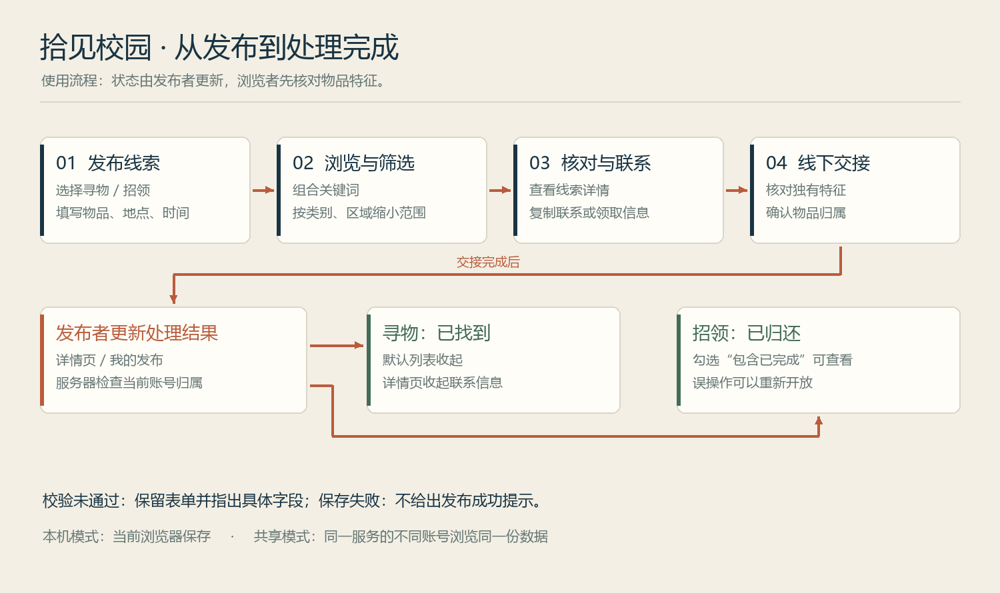
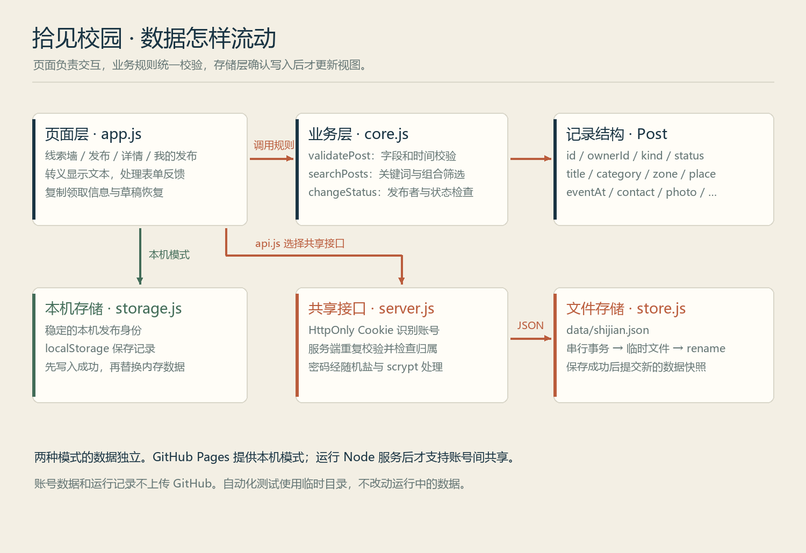

# 拾见校园 · 校园失物招领

软件工程结对作业第二次（程序实现）。

把寻物、招领消息做成一张张“校园线索卡”：先看时间和地点，再核对物品特征，最后由发布者更新结果。

- [在线体验（本机保存模式）](https://grim761.github.io/082403146-102401221/)
- [作业要求](https://edu.cnblogs.com/campus/fzu/2026-01SoftwareEngineeringandSoftwareEngineeringPractice/homework/16745)
- [此前的交互原型](https://grim761.github.io/campus-lost-found-prototype/)
- [测试报告](docs/测试报告.md) · [开发计划](docs/开发计划.md) · [协作与提交说明](docs/协作与提交说明.md)

## 1. 已实现的功能

| 任务 | 操作与结果 |
| --- | --- |
| 发布寻物 / 招领 | 填写名称、类别、时间、区域、具体地点和领取信息；可附一张图片 |
| 查找线索 | 按关键词、类别、区域、类型和状态共同筛选；支持多个空格分隔的关键词 |
| 查看与联系 | 详情展示线索，可复制联系方式或领取地点 |
| 物品展示 | 优先显示上传照片；没有照片时，钥匙、伞、耳机、卡片等显示对应插画，名称不明确时使用类别图标 |
| 处理完成 | 发布者在详情 / 我的发布中标记“已找到”“已归还”；可以重新开放 |
| 持久保存 | 本机模式保存到浏览器；共享模式保存到服务端 JSON 文件 |
| 减少误操作 | 字段校验、即时卡片预览、文字草稿恢复、状态更新前确认 |
| 状态反馈 | 完成线索默认收起；勾选“包含已完成”可看历史；详情收起领取信息 |

页面中的九条初始线索均为虚构示例。联系方式和领取地点仅用于演示。

## 2. 直接打开 HTML（无需安装开发环境）

1. 在 GitHub 点击 **Code → Download ZIP**，完整解压。
2. 用 **Chrome** 打开项目根目录的 `index.html`；保留旁边的 `css`、`js` 文件夹。
3. 页面右上角显示“本机保存”，可以发布、搜索和更新自己的记录。
4. 刷新后数据仍从当前浏览器存储读取；清理浏览器数据会移除记录。可用页脚“导出本机备份”保存 JSON 副本。

这一路径使用经典脚本和相对路径，没有构建步骤、CDN 或外部字体。`file://` 下的 localStorage 行为由浏览器决定；若存储被禁用，页面会显示“临时模式”，不会声称已持久保存。[MDN 的说明](https://developer.mozilla.org/en-US/docs/Web/API/Window/localStorage)也提示本地文件的存储行为没有统一保证。需要稳定来源时，使用下面的本地服务或在线静态页面。

本机身份属于当前浏览器，适合个人体验；不同设备不会同步，也不能当作多用户认证。公开体验页面同样是本机模式。

本机旧记录损坏时不会覆盖原数据；导出的备份会附带 `recoveryOriginalRaw` 原始字符串，便于后续检查恢复。普通备份没有这一字段。

## 3. 运行共享服务（推荐用于完整演示）

需要 **Node.js 22 或更新版本**。本项目没有第三方 npm 依赖，无需运行 `npm install`。

```bash
git clone https://github.com/Grim761/082403146-102401221.git
cd 082403146-102401221
npm start
```

也可以直接运行 `node server/server.js`。看到启动提示后，用 Chrome 访问 **http://127.0.0.1:8787**；右上角应显示“共享服务”。

完整演示顺序：

1. 账号 A 注册，发布一条寻物或招领；登录后可以在“我的发布”找到它。
2. 另一个浏览器 / Chrome 无痕窗口打开同一个服务，账号 B 浏览并按关键词查找这条记录。
3. B 查看详情、复制领取信息；B 没有更新 A 记录的入口。即使直接请求接口也会被拒绝。
4. A 标记“已找到”或“已归还”；B 点击“刷新线索”，勾选“包含已完成”查看更新结果。
5. 重启服务后，账号和发布记录仍保留；内存会话会重置，需要重新登录。

服务器默认只监听本机。要在同一局域网演示，可在 PowerShell 中启动：

```powershell
$env:HOST = '0.0.0.0'
$env:PORT = '8787'
node server/server.js
```

其他设备访问这台电脑的局域网 IP 和端口；是否可达取决于本机防火墙与网络。演示结束关闭终端，再清除本次设置的 `HOST`、`PORT` 环境变量。此服务用于教学和可信网络演示；正式公网部署还需要 HTTPS、运维备份和更完整的访问管理。

首次运行自动生成 `data/shijian.json`。该目录已被 Git 忽略，包含账号密码的随机盐、派生值和发布数据，不应上传。备份前先停止服务，再复制这个文件；文件损坏时服务拒绝启动，不覆盖原数据。当前文件存储只支持**一个服务进程**，不用于多实例部署。

## 4. 文件结构

```text
082403146-102401221/
├── index.html                # 页面入口，经典脚本按依赖顺序加载
├── css/style.css             # 纸色线索卡布局，含移动端断点
├── js/
│   ├── core.js               # 校验、搜索、状态变更等业务函数
│   ├── seed.js               # 虚构示例线索
│   ├── storage.js            # 本机身份、数据保存、文字草稿、备份
│   ├── api.js                # 选择本机 / 共享模式，封装请求
│   └── app.js                # 路由、渲染、表单、图片、复制、弹窗
├── server/
│   ├── server.js             # 静态页面与 JSON API、账号与会话
│   └── store.js              # 单进程事务队列和文件保存
├── tests/
│   ├── core.test.js          # 18 项业务单元测试
│   ├── storage.test.js       # 9 项本机存储单元测试
│   └── server.test.js        # 14 项接口与集成测试
├── docs/                     # 计划、报告、图示和操作截图
├── tools/draw_diagrams.py    # 图示生成源文件（运行需 Pillow）
├── .github/workflows/        # 自动测试与 Pages 静态部署
└── package.json              # start / test 命令，无第三方依赖
```

`tools` 只是生成文档图示的工具，不是网页运行依赖。私有草稿、运行数据和压缩包不会随仓库提交。

## 5. 设计和数据流





`Post` 保存物品信息、发布者 ID、状态、发生时间、创建时间和更新时间；界面根据 `kind + status` 生成“寻找中 / 招领中 / 已找到 / 已归还”。共享模式的发布者 ID 从登录会话读取，客户端不能靠提交另一个 `ownerId` 取得权限。

所有展示文本先做 HTML 转义。图片仅接受 JPEG、PNG、WebP，浏览器压缩后保存；不接受 SVG 或远程图片链接。完成状态只收起界面的联系方式，原字段仍在存储中，**不等于删除或撤回已经公开过的数据**。

## 6. 自动化测试

```bash
npm test
# 查看 Node 测试加载模块的覆盖报告
node --test --experimental-test-coverage tests/core.test.js tests/storage.test.js tests/server.test.js
```

使用 Node 内置 `node:test` 和 `node:assert/strict`，测试不启动固定端口，不改动正在运行的数据。接口测试监听临时端口并使用系统临时目录。

2026-10-10 本地 Node v24.19.0 结果：**41 项通过、0 项失败**；其中 27 项是单元测试，14 项是接口与集成测试。覆盖率和白盒用例见[测试报告](docs/测试报告.md)。覆盖统计不含 DOM 页面交互脚本，不能替代浏览器走查。

## 7. 当前范围

- 已有共享数据、账号归属和持久保存；没有即时聊天、地图、实名认证或管理后台。
- 文字草稿可恢复；图片草稿需重新选图，避免自动保存大图占满浏览器空间。
- 共享列表按页面切换 / 手动刷新更新，没有实现实时推送。
- 本机备份支持导出，当前没有直接导入入口。
- GitHub Pages 只托管静态文件，不运行 Node 后端。[Pages 自定义部署文档](https://docs.github.com/en/pages/getting-started-with-github-pages/using-custom-workflows-with-github-pages)是部署配置参考。

## 8. 来源

本项目从此前“拾见校园”原型继续实现，未套用第三方失物招领项目或同学作业代码。原型链接见页首。学习参考只包括 [MDN Web 文档](https://developer.mozilla.org/zh-CN/)、[Node 测试文档](https://nodejs.org/api/test.html)和 GitHub 官方部署说明。
